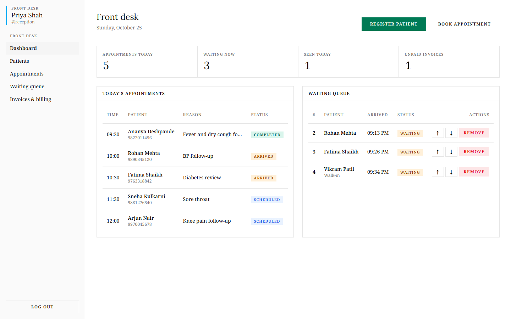
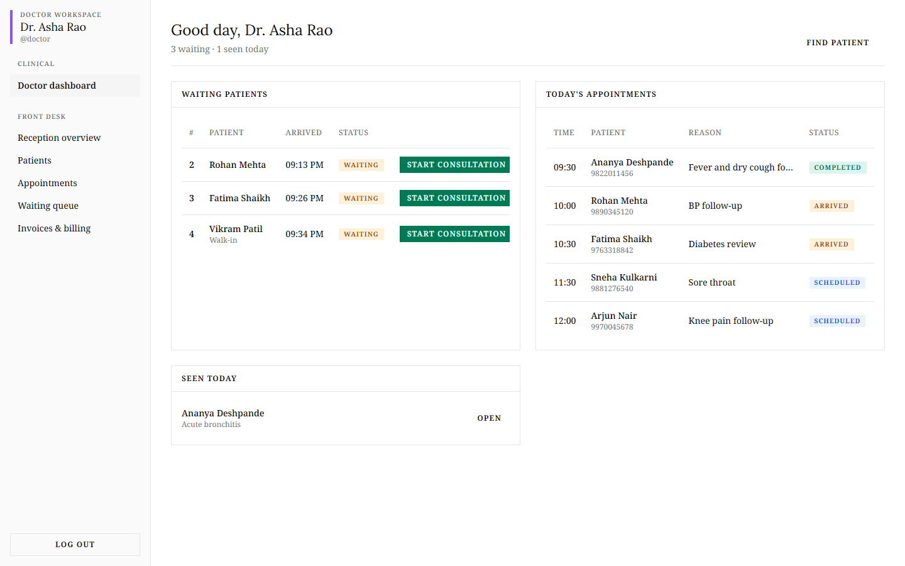
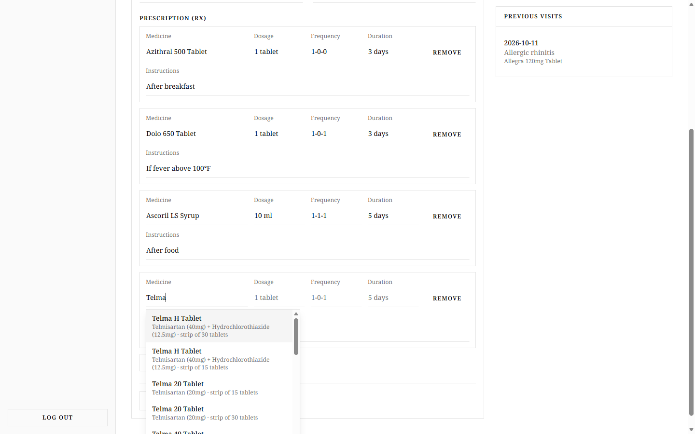
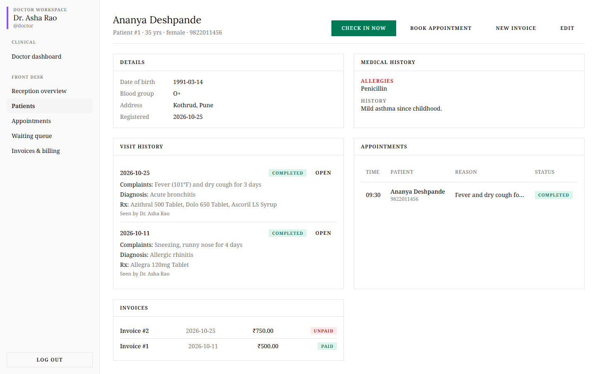
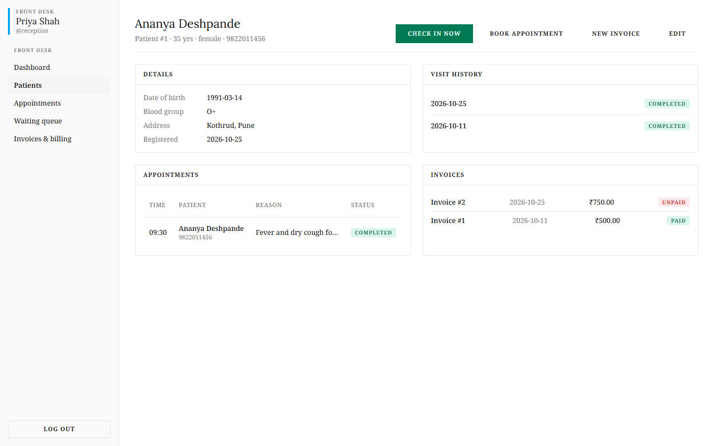
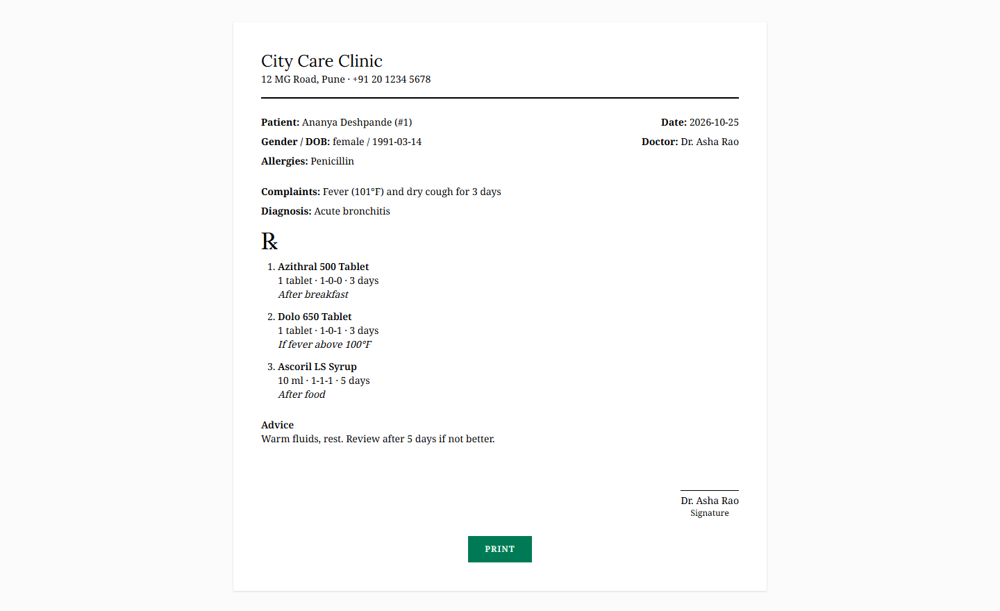
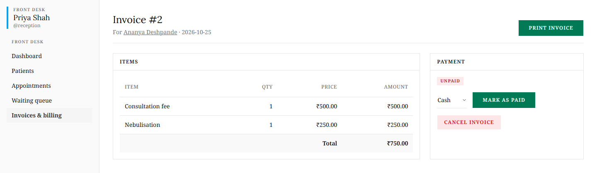
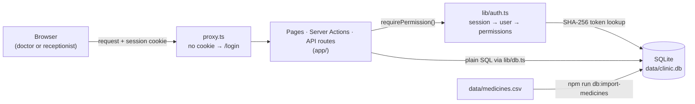

<div align="center">


# Clinicdesk

**One login for the whole clinic: the front desk runs the day, the doctor runs the consultation.**

A role-based clinic management app for doctors and receptionists: patient registration, appointments, a live waiting queue, prescriptions with medicine autocomplete, and billing.

<p>
  
  
  
  
  
  
</p>

<a href="#-quick-start">Quick start</a> ·
<a href="#-screenshots">Screenshots</a> ·
<a href="#-features">Features</a> ·
<a href="#-roles--permissions">Roles &amp; permissions</a> ·
<a href="#-architecture">Architecture</a> ·
<a href="#-project-structure">Project structure</a>

</div>

<br />

<p align="center">
  
  <br />
  <sub>The front-desk dashboard: today's appointments, the live waiting queue and daily counts.</sub>
</p>

## Overview

Small clinics often run on paper registers, a token counter and a separate billing book. Clinicdesk puts that workflow in one place:

1. The **receptionist** registers the patient, books or checks them in, and they join the **waiting queue**.
2. The **doctor** calls the next patient, records complaints, diagnosis and notes, and writes a **prescription**, picking medicines from a dataset of ~254,000 Indian medicines.
3. The front desk **bills** the visit, marks it paid and prints the invoice. The doctor prints the prescription.

Both roles sign in on the **same login page**. The role is stored in the database, never chosen at login, and every page, Server Action and API route checks permissions **on the server**.

## 📸 Screenshots

> Screenshots were captured from a local production build (`next build && next start`) using a sample database. The patients and visits are made-up demo data; the medicine suggestions come from the real CSV dataset.

<table>
  <tr>
    <td width="50%" valign="top">
      
      <p align="center"><sub><b>Doctor dashboard</b>: waiting patients with “Start consultation”, today's appointments and patients seen today.</sub></p>
    </td>
    <td width="50%" valign="top">
      
      <p align="center"><sub><b>Consultation &amp; prescription</b>: typing “Telma” suggests matching medicines with composition and pack size.</sub></p>
    </td>
  </tr>
  <tr>
    <td width="50%" valign="top">
      
      <p align="center"><sub><b>Patient profile: doctor view</b>. Allergies, medical history, diagnoses and prescriptions from every visit.</sub></p>
    </td>
    <td width="50%" valign="top">
      
      <p align="center"><sub><b>Same patient: receptionist view</b>. Visit dates and billing only; clinical data is never sent to the browser.</sub></p>
    </td>
  </tr>
  <tr>
    <td width="50%" valign="top">
      
      <p align="center"><sub><b>Printable prescription</b> with letterhead, allergies, ℞ list, advice and signature line.</sub></p>
    </td>
    <td width="50%" valign="top">
      
      <p align="center"><sub><b>Invoice &amp; payment</b>: line items, total, mark paid (cash / UPI / card), cancel or print.</sub></p>
      <br />
      
      <p align="center"><sub><b>One shared sign-in</b> for both roles.</sub></p>
      
      <p align="center"><sub>A receptionist opening a doctor-only URL is stopped by the server.</sub></p>
    </td>
  </tr>
</table>

## ✨ Features

<table>
  <tr>
    <th align="left">Front desk (receptionist &amp; doctor)</th>
    <th align="left">Clinical (doctor only)</th>
  </tr>
  <tr>
    <td valign="top">

- Register and edit patients; search by name, phone or ID
- Book, reschedule, cancel or mark appointments as no-show
- Mark arrivals: the patient joins today's numbered queue
- Walk-in check-in, reorder the queue (↑ ↓), remove a patient
- Patient profile with visit history, appointments and invoices
- Create itemised invoices, mark paid (cash/UPI/card), cancel
- Printable invoices

</td>
    <td valign="top">

- Doctor dashboard: waiting patients, today's appointments, seen today
- Start a consultation straight from the queue
- Record complaints, diagnosis, clinical notes and advice
- Create and edit prescriptions (dosage, frequency, duration, instructions)
- Medicine autocomplete from the imported CSV (keyboard friendly)
- View allergies, medical history and all previous visits and prescriptions
- Printable prescriptions

</td>
  </tr>
</table>

## 🔐 Roles & permissions

Every action is guarded by a permission from [`lib/permissions.ts`](lib/permissions.ts). Doctors get every receptionist permission plus the clinical ones.

| Permission | What it allows | Receptionist | Doctor |
| --- | --- | :---: | :---: |
| `patients:read` | Search patients, view profiles and visit dates | ✅ | ✅ |
| `patients:write` | Register and edit patients | ✅ | ✅ |
| `appointments:manage` | Book, reschedule, cancel appointments | ✅ | ✅ |
| `queue:manage` | Check in patients, maintain the waiting queue | ✅ | ✅ |
| `invoices:manage` | Create invoices, update payment status, print | ✅ | ✅ |
| `clinical:read` | View diagnoses, notes, medical history, prescriptions | ❌ | ✅ |
| `clinical:write` | Record consultations, write prescriptions, medicine search | ❌ | ✅ |

**How it is enforced**

- **On the server, at every entry point.** Pages and Server Actions call `requirePermission(...)` from [`lib/auth.ts`](lib/auth.ts); API routes call `checkApiPermission(...)` and return `401`/`403` JSON. Hiding buttons is only a convenience.
- **Field-level checks.** A receptionist can edit a patient's contact details, but the server ignores `allergies` and `medical_history` unless the user has `clinical:write`.
- **Explicit grants.** To let a specific receptionist see clinical data, add the permission to their `extra_permissions` column (e.g. `clinical:read`).
- **Sessions.** Login creates a random 256-bit token in an `httpOnly`, `SameSite=Lax` cookie; the database stores only its SHA-256 hash. Logging out deletes the row, so the cookie stops working immediately. Passwords are hashed with bcrypt (cost 12).
- **Early redirect.** [`proxy.ts`](proxy.ts) sends requests without a session cookie to `/login` (or returns `401` for `/api/*`) before any page renders.

## 🏗 Architecture



- **Rendering:** Next.js App Router with Cache Components. Every page has a `loading.tsx`, so navigation shows a skeleton instantly while the server renders the page.
- **Writes:** all changes go through Server Actions in [`app/actions/`](app/actions); each one re-checks permissions.
- **Database:** Node's built-in [`node:sqlite`](https://nodejs.org/api/sqlite.html) with plain SQL. One file holds users, sessions and clinic data. The full schema is in [`lib/schema.mjs`](lib/schema.mjs).

<details>
<summary><b>Database tables</b></summary>

| Table | Purpose |
| --- | --- |
| `users` | `id`, `name`, `username`, `password_hash`, `role` (`doctor` / `receptionist`), `extra_permissions` |
| `sessions` | Hashed session tokens with expiry (7 days) |
| `patients` | Demographics, contact details, allergies, medical history |
| `appointments` | Date, time, reason, status (`scheduled`, `arrived`, `completed`, `cancelled`, `no_show`) |
| `visits` | One per arrival: queue number, status, complaints, diagnosis, notes, advice, doctor |
| `prescription_items` | Medicines on a visit's prescription |
| `invoices`, `invoice_items` | Bills, line items, payment status and method |
| `medicines` | Imported from the CSV for autocomplete |

</details>

## 🚀 Quick start

**Requirements:** Node.js **22.13 or newer** (for `node:sqlite`; developed on Node 26) and npm.

```bash
git clone <your-repo-url> clinicdesk
cd clinicdesk
npm install
```

The medicine autocomplete needs the **A–Z Medicines Dataset of India** CSV. It is not committed (≈32 MB), so place it at `data/medicines.csv`. The expected columns are:

```text
id,name,price(₹),Is_discontinued,manufacturer_name,type,pack_size_label,short_composition1,short_composition2
```

Then create the database, the starter accounts and the medicine table, and start the app:

```bash
npm run setup
npm run dev
```

Open <http://localhost:3000> and sign in. `npm run setup` prints:

```text
Saved doctor account "doctor".
Saved receptionist account "reception".
Passwords are the defaults in scripts/seed.mjs unless you set the SEED_* env vars.
Imported 253973 medicines from data/medicines.csv.
```

| Username | Role | Lands on |
| --- | --- | --- |
| `doctor` | Doctor | `/doctor` |
| `reception` | Receptionist | `/reception` |

The starter passwords are development defaults defined in [`scripts/seed.mjs`](scripts/seed.mjs). **Change them before using real patient data** (see below).

### Production build

```bash
npm run build
npm start
```

## 🧭 Usage

A typical day:

1. **Receptionist** → *Patients* → **Register patient** (or search an existing one).
2. From the profile, **Book appointment**, or **Check in now** for a walk-in.
3. On the day, click **Arrived** next to the appointment. The patient appears in the **Waiting queue** with a number.
4. **Doctor** → *Doctor dashboard* → **Start consultation**. Fill in complaints, diagnosis and notes, add medicines (start typing, then pick with ↑ ↓ Enter), and press **Save & complete visit**.
5. **Print prescription** from the visit page.
6. **Receptionist** → *Waiting queue* → *Finished today* → **Bill** → add items → **Create invoice** → **Mark as paid** → **Print invoice**.

### Managing staff accounts

```bash
# Create a user, or reset an existing user's name/role/password
npm run user:create -- <doctor|receptionist> <username> "<Full Name>" <password>

# Example
npm run user:create -- doctor drmehta "Dr. Anil Mehta" "a-strong-password"
```

Usernames are case-insensitive and passwords must be at least 8 characters.

## 📜 Scripts

| Command | Description |
| --- | --- |
| `npm run dev` | Start the development server |
| `npm run build` / `npm start` | Production build / serve it |
| `npm run lint` | Run ESLint |
| `npm run setup` | `db:seed` + `db:import-medicines` |
| `npm run db:seed` | Create or update the `doctor` and `reception` starter accounts |
| `npm run db:import-medicines [-- file.csv]` | (Re)import the medicines CSV, default `data/medicines.csv` |
| `npm run user:create -- …` | Create or update a staff account |

## ⚙️ Configuration

No environment variables are required. Optional settings:

| Variable | Default | Used by |
| --- | --- | --- |
| `DATABASE_PATH` | `data/clinic.db` | App and all scripts: location of the SQLite file |
| `SEED_DOCTOR_PASSWORD` | value in `scripts/seed.mjs` | `npm run db:seed` |
| `SEED_RECEPTIONIST_PASSWORD` | value in `scripts/seed.mjs` | `npm run db:seed` |
| `NODE_ENV` | set by Next.js | When `production`, the session cookie is marked `Secure` (HTTPS only) |

`data/*.db` and `data/*.csv` are git-ignored, so patient data and the large dataset never end up in the repository.

## 🗂 Project structure

```text
app/
├── (app)/                 # Logged-in pages, sharing the role-aware sidebar layout
│   ├── layout.tsx         # Reads the session, builds doctor vs receptionist navigation
│   ├── doctor/            # Doctor dashboard (clinical:write)
│   ├── reception/         # Front-desk dashboard
│   ├── patients/          # Search, register, profile, edit
│   ├── appointments/      # Day view, booking, reschedule
│   ├── queue/             # Waiting queue and walk-in check-in
│   ├── invoices/          # List, create, payment status
│   └── visits/[id]/       # Consultation + prescription editor (doctor)
├── actions/               # Server Actions: auth, patients, appointments, queue, visits, invoices
├── api/medicines/         # GET ?q= → medicine autocomplete (clinical:write)
├── api/me/                # GET → current user and permissions
├── print/                 # Printable invoice and prescription pages
├── login/                 # Shared sign-in page
└── forbidden/             # 403 page
components/app/            # App components (tables, forms, autocomplete, loading skeleton)
components/ui/             # shadcn/ui (Base UI) primitives
lib/
├── schema.mjs             # All tables in plain SQL (shared by app and scripts)
├── db.ts                  # SQLite connection + all/get/run/transaction helpers
├── session.ts             # Session cookie create / read / delete
├── auth.ts                # getCurrentUser, requirePermission, checkApiPermission
├── permissions.ts         # Roles, permissions, role → permissions map
└── queries.ts             # Shared read queries
scripts/                   # seed, create-user, import-medicines
proxy.ts                   # Redirects requests without a session cookie to /login
docs/images/               # README logo and screenshots
```

## 🧪 Testing

There is no automated test suite yet. The available checks are:

```bash
npm run lint
npx tsc --noEmit
npm run build
```

`tsc` and `build` pass. `npm run lint` currently reports two `react-hooks/set-state-in-effect` errors in shadcn-generated files the app does not use (`components/ui/carousel.tsx`, `hooks/use-mobile.ts`); the application code itself lints cleanly.

During development both roles were checked manually against a production build, including by replaying real Server Action requests with the other role's cookie:

| Check | Result |
| --- | --- |
| Wrong password is rejected; no session cookie is set | Passed |
| `doctor` → `/doctor`, `reception` → `/reception` after login | Passed |
| An extra `role=doctor` field in the login form is ignored | Passed |
| `/api/medicines`: logged out `401`, receptionist `403`, doctor gets results | Passed |
| Receptionist replaying the doctor's *Start consultation* / *Save consultation* actions changes nothing | Passed |
| Receptionist cannot write `allergies` / `medical_history` via the edit form | Passed |
| Receptionist's profile and edit pages contain no allergy or medical-history values in the HTML | Passed |
| Doctor can open every receptionist page | Passed |
| After logout the old session cookie is rejected (`401`) | Passed |

## 🛣 Future improvements

Not implemented yet:

- Automated tests (permission matrix, Server Actions, queue logic) in CI
- Fix or remove the unused shadcn components that currently fail lint
- An admin screen for managing staff accounts and `extra_permissions`
- Login rate limiting / lockout after repeated failures
- Configurable clinic name and address on printouts (currently set in [`components/app/letterhead.tsx`](components/app/letterhead.tsx))
- Fee presets and GST/tax lines on invoices
- Appointment reminders (SMS / WhatsApp) and daily reports

## 🙏 Acknowledgements

- Medicine data: the **A–Z Medicines Dataset of India** (CSV), imported locally and not redistributed in this repository.
- Built with [Next.js](https://nextjs.org), [React](https://react.dev), [Tailwind CSS](https://tailwindcss.com), [shadcn/ui](https://ui.shadcn.com) on [Base UI](https://base-ui.com), [Remix Icon](https://remixicon.com) and [bcrypt.js](https://github.com/dcodeIO/bcrypt.js).
